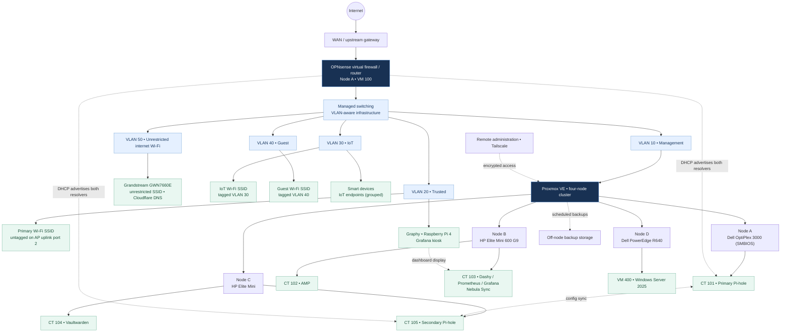
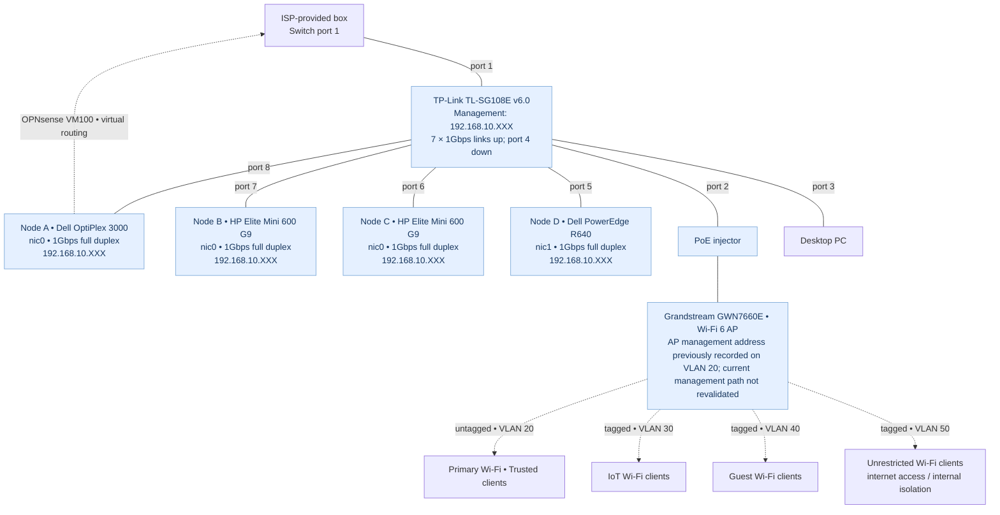
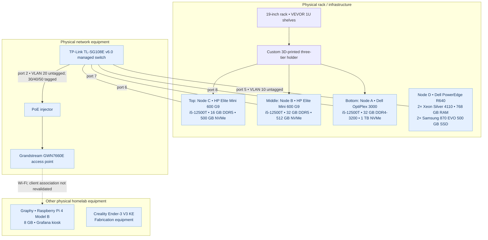

# Homelab Network Architecture

**Updated:** November 5, 2026 (SSID mappings and physical port 2/5 assignments confirmed)

The first diagram is a **logical topology**; the physical section below includes the operator-confirmed eight-port cable map. It documents network segmentation, cluster placement, and service relationships. Physical uplinks and upstream WAN details are intentionally simplified. Dotted arrows indicate logical dependencies rather than physical cabling.

## Current Logical Network Diagram

[Open standalone Mermaid source](homelab-network.mmd)

## Physical Network Topology (verified October 30, 2026)

**Public documentation convention:** Internal host IP addresses are partially masked (for example, `192.168.20.XXX`), and physical MAC addresses are redacted. Exact host addresses and device-specific network identifiers are intentionally not published here.

Physical port assignments were supplied by the operator on October 31, 2026. VLAN membership and PVID values were subsequently verified against screenshots of the TP-Link management interface; port status and negotiated speeds were subsequently confirmed from the switch Port Setting screenshot. The PoE injector is inline between the switch and wireless AP. Dotted connections are Wi-Fi or logical associations, not additional Ethernet cables. Port 1 connects to the ISP-provided box; its routing role beyond that physical connection has not been independently verified. All four SSID-to-VLAN mappings were verified from the AP SSID list and switch port 2 configuration on November 5, 2026.

### Managed switch: port state and VLAN configuration

**Switch:** TP-Link TL-SG108E v6.0, management IP `192.168.10.XXX`, MAC masked, firmware `1.0.0 Build 20230218 Rel.50633`. 802.1Q VLAN is enabled. All eight ports are administratively enabled, configured for auto-negotiation with flow control off. The latest Port Setting screenshot confirms ports 1–3 and 5–8 at 1000 Mbps full duplex (`1000MF`), with port 4 link down. All eight ports are administratively enabled, speed/duplex set to Auto, and configured and actual flow control Off.

| Port | Observed link | PVID | Untagged VLAN | Tagged VLANs | Connected device |
|---|---|---|---|---|---|
| 1 | 1Gbps full (verified) | 100 | 100 | — | ISP-provided box (operator-confirmed) |
| 2 | 1Gbps full (historical) | 20 | 20 | 30, 40, 50, 100 | Grandstream GWN7660E via PoE injector (latest confirmation) |
| 3 | 1Gbps full (verified) | 10 | 10 | — | Desktop PC (operator-confirmed) |
| 4 | Down (historical) | 10 | 1 | — | Empty (operator-confirmed) |
| 5 | 1Gbps full (historical) | 10 | 10 | 30, 40, 50 | HomeProx4 • Dell PowerEdge R640 (operator-confirmed November 5) |
| 6 | 1Gbps full (verified) | 10 | — | 10, 20, 30, 40, 50, 100 | HomeProx3 (operator-confirmed) |
| 7 | 1Gbps full (verified) | 10 | — | 10, 20, 30, 40, 50, 100 | HomeProx2 (operator-confirmed) |
| 8 | 1Gbps full (verified) | 10 | — | 10, 20, 30, 40, 50, 100 | HomeProx (node 1; operator-confirmed) |

These are the switch's **configured** VLAN memberships, verified from the 802.1Q VLAN Configuration and PVID Setting screenshots provided by the operator. 802.1Q VLAN is enabled. These settings do not by themselves prove each connected endpoint's VLAN behavior. VLAN 1 has port 4 as an untagged member; port 4 has PVID 10, a mismatch between untagged membership and ingress classification that is recorded without asserting connectivity behavior. Port 1 is confirmed connected to the ISP-provided box, but the VLAN 100 setting alone does not establish its precise routing role.

### Wireless SSID-to-VLAN mapping (verified November 5, 2026)

The Grandstream GWN7660E SSID configuration and TP-Link TL-SG108E v6.0 VLAN/PVID screenshots establish the following configured mappings. SSID names are represented by public-facing aliases.

| Public SSID alias | VLAN | AP tagging | Switch port 2 membership | Purpose |
|---|---|---|---|---|
| Primary Wi-Fi | 20 | Untagged (no SSID VLAN ID) | Untagged; PVID 20 | Trusted network |
| IoT Wi-Fi | 30 | Tagged | Tagged | IoT |
| Guest Wi-Fi | 40 | Tagged | Tagged | Guest |
| Unrestricted Wi-Fi | 50 | Tagged | Tagged | Internet without Pi-hole filtering |

All four SSIDs are enabled on 2.4 GHz and 5 GHz, with bridge client IP assignment. The primary Wi-Fi SSID uses the trusted VLAN; switch VLAN settings alone do not establish client-to-service firewall reachability. VLAN 20 is untagged on switch port 2. A Skemp2 client received an address ending .20.79 and gateway ending .20.1. These observations describe configuration, not a new end-to-end client traffic test.

### Physical interface verification

| Node | Active physical NIC | MAC | Link | Management configuration |
|---|---|---|---|---|
| Node A | `nic0` | `XX:XX:XX:XX:XX:XX` | 1Gbps full | `vmbr0.10` • `192.168.10.XXX/24` |
| Node B | `nic0` | `XX:XX:XX:XX:XX:XX` | 1Gbps full | `vmbr0.10` • `192.168.10.XXX/24` |
| Node C | `nic0` | `XX:XX:XX:XX:XX:XX` | 1Gbps full | `vmbr0.10` • `192.168.10.XXX/24` |
| Node D | `nic1` | `XX:XX:XX:XX:XX:XX` | 1Gbps full | `vmbr0` • `192.168.10.XXX/24` |

Node A, Node B and Node C have VLAN-aware `vmbr0` bridges. Node D's `vmbr0` is **not** configured as VLAN-aware in `/etc/network/interfaces`; its other three physical interfaces have no detected link. Node D is directly connected to the TL-SG108E, as confirmed by the operator. The AP is connected to switch port 2 **through a PoE injector**; the VLAN 50 SSID has been deployed and tested, and all four SSID VLAN assignments were checked against the AP and switch configuration on November 5, 2026. A 15-second LLDP capture on Node A observed no advertisements, so the physical port mapping relies on the operator's direct cable inventory rather than LLDP.

### Switch verification summary

Operator-provided switch screenshots confirm 802.1Q enabled, VLAN membership and PVID values, and live port settings. Seven ports (1–3 and 5–8) are up at 1000 Mbps full duplex; port 4 is down and physically empty. All ports are administratively enabled with auto-negotiation and flow control off. Physical device assignments were confirmed by the operator. This completes the switch port documentation audit, without claiming end-to-end VLAN or traffic tests beyond those already recorded.

## Physical Hardware Layout

The following diagram inventories the physical platforms separately from the virtual service topology above.

## Physical Hardware Inventory

**Model verification (November 5, 2026):** Node A reports **Dell OptiPlex 3000** via `dmidecode`. CPU, RAM, NVMe drive, and Ethernet controller were checked directly on the Proxmox host. The chassis form factor was not separately identified by this command.

This inventory documents **known, currently used** homelab hardware. Hardware specifications not confirmed from current records are deliberately left unspecified. The inventory is distinct from the logical network diagram; connections below do not assert verified switch-port assignments.

| Node / device | Physical hardware | Known details / current use |
|---|---|---|
| **Node A** | Dell OptiPlex 3000 (`dmidecode` verified) | Intel Core i5-12500T (6 cores / 12 threads); 2 × 16 GB DDR4-3200 (32 GB installed); Samsung 970 EVO Plus 1 TB NVMe; Realtek RTL8111/8168-family Gigabit Ethernet; Proxmox LVM-thin pool ~794 GiB; bottom tier; primary Pi-hole CT101 and OPNsense VM100 |
| **Node B** | HP Elite Mini 600 G9 Desktop PC | Intel Core i5-12500T (6 cores / 12 threads); 2 × 16 GB Micron DDR5-5600 running at 4800 MT/s; Samsung PM9A1 512 GB NVMe; Intel I219-LM Gigabit Ethernet; middle tier; AMP CT102 and monitoring CT103; NFS backup storage on root filesystem |
| **Node C** | HP Elite Mini 600 G9 Desktop PC | Intel Core i5-12500T (6 cores / 12 threads); 8 GB Samsung + 8 GB SK Hynix DDR5-4800; Samsung SSD 980 500 GB NVMe; Intel I219-LM Gigabit Ethernet; top tier; secondary Pi-hole CT105 and Vaultwarden CT104 |
| **Node D** | Dell PowerEdge R640 | 2 × Intel Xeon Silver 4110 (16 cores / 32 threads total); 24 × 32 GB registered ECC DDR4-2666 operating at 2400 MT/s (768 GB installed, ~754 GiB Linux-reported); 2 × Samsung 870 EVO 500 GB SATA SSDs; 2 × Broadcom BCM5720 Gigabit Ethernet and 2 × BCM57412 10GbE ports (three of four physical interfaces have no link; nic1 active at 1Gbps); Windows Server VM |
| **Managed switch** | TP-Link TL-SG108E v6.0 | Managed Switch; 192.168.10.XXX; seven active 1Gbps links; port 4 down; VLAN/PVID table above |
| **Wireless access point** | Grandstream GWN7660E | 192.168.20.XXX (VLAN 20); connected to TL-SG108E through a PoE injector; port 2 confirmed; four SSID VLAN mappings verified from AP and switch screenshots |
| **PoE injector** | Model unverified | Inline between managed switch and GWN7660E access point |
| **Monitoring kiosk** | Raspberry Pi 4 Model B Rev 1.5 | 8 GB RAM; Graphy Grafana kiosk on trusted VLAN 20; Debian 13 (last reported) |
| **Rack** | 19-inch rack with VEVOR 1U vented cantilever shelves | 10-inch-deep shelves; 12-24 threaded rack mounting hardware and washers |
| **Micro-PC organizer** | Custom 3D-printed three-tier holder | Holds Node A, Node B and Node C; M4 bolts and heat-set inserts |
| **3D printer** | Creality Ender-3 V3 KE | Used to fabricate the custom holder and other lab components; fabrication equipment, not a confirmed VLAN endpoint |

## New wireless VLAN 50 case study

[Unrestricted internet SSID deployment and DHCP troubleshooting](../opnsense-vlan-architecture/case-studies/unrestricted-wireless-vlan50.md) documents VLAN 50 tagging, Proxmox-to-OPNsense forwarding, Dnsmasq DHCP recovery, Cloudflare DNS testing, and internal-service isolation. All eight switch-port device assignments were subsequently confirmed by the operator on October 31, 2026; VLAN memberships and PVIDs were rechecked from switch UI screenshots. Live link states were also rechecked: ports 1–3 and 5–8 up at 1000 Mbps full duplex, port 4 down.

## Segmentation and routing

| Network | Purpose | Documentation status |
|---|---|---|
| VLAN 10 | Infrastructure management | In use |
| VLAN 20 | Trusted clients, including Graphy | In use |
| VLAN 30 | IoT segment; Smart devices grouped beneath VLAN 30 in the logical diagram | Configured; DNS enforcement client validation pending |
| VLAN 40 | Guest segment | Configured; DNS enforcement client validation pending |
| VLAN 50 | Dedicated unrestricted-internet Wi-Fi, Cloudflare DNS, internal IPv4 isolation | Operational; validation confirmed complete by operator |

OPNsense handles inter-network policy. The primary and secondary Pi-hole instances are advertised as DNS resolvers; their independent operation and Nebula Sync synchronization have been tested, but Node A Linux resolver fallback has passed a simulated unavailable-primary test; Windows and other client failover remain unverified. Direct-DNS bypass rules were configured for four networks; comprehensive client testing and DNS-over-HTTPS controls remain outstanding.

The **Smart devices** node is a logical grouping for IoT endpoints, not a verified device inventory or claim that specific devices have joined VLAN 30.

## Four-node virtualization cluster

- **Node A:** OPNsense VM 100 and primary Pi-hole CT 101.
- **Node B:** AMP CT 102 and monitoring/application stack CT 103 (Dashy, Prometheus, Grafana, exporters, Nebula Sync).
- **Node C:** Vaultwarden CT 104 and secondary Pi-hole CT 105.
- **Node D:** Windows Server 2025 VM 400.

## Access and monitoring

Tailscale enables remote administrative access. Graphy is a Raspberry Pi 4 kiosk on the trusted network displaying Grafana dashboards; it is a display endpoint, not a monitoring server.

## Scope and limitations

This diagram records operator-confirmed physical switch-port assignments and screenshot-verified VLAN memberships/PVIDs but does **not** assert redundant physical network paths, OPNsense HA, DNS client failover, or completed Windows Active Directory deployment. Management IPs are included for topology documentation; credentials and firewall rule details are omitted.

**November 5 physical topology confirmation:** AP on switch port 2 (via PoE injector); Dell PowerEdge R640 on switch port 5. Both the physical network and hardware layout diagrams above reflect these assignments.
