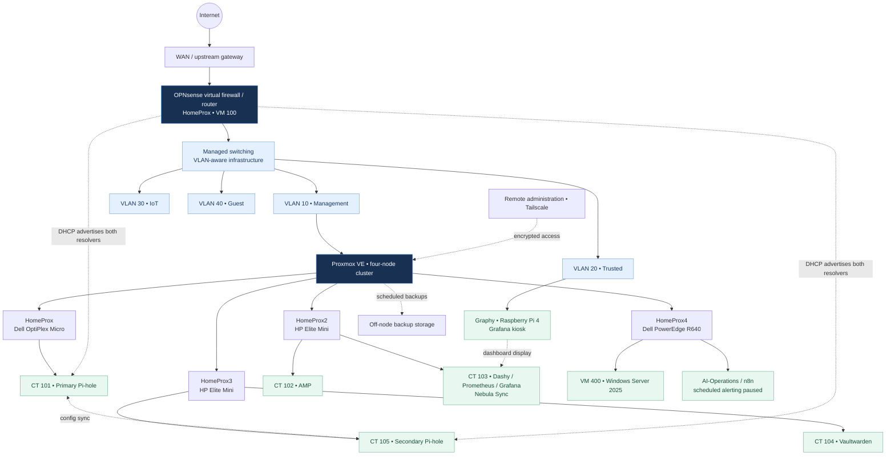

# Homelab Network Architecture

**Updated:** October 26, 2026

This is a **logical topology**, not a verified port-by-port cable map. It documents network segmentation, cluster placement, and service relationships. Physical uplinks and upstream WAN details are intentionally simplified. Dotted arrows indicate logical dependencies rather than physical cabling.

## Current Logical Network Diagram

[Open standalone Mermaid source](homelab-network.mmd)

## Segmentation and routing

| Network | Purpose | Documentation status |
|---|---|---|
| VLAN 10 | Infrastructure management | In use |
| VLAN 20 | Trusted clients, including Graphy | In use |
| VLAN 30 | IoT segment | Configured; DNS enforcement client validation pending |
| VLAN 40 | Guest segment | Configured; DNS enforcement client validation pending |

OPNsense handles inter-network policy. The primary and secondary Pi-hole instances are advertised as DNS resolvers; their independent operation and Nebula Sync synchronization have been tested, but automatic client failover is **not verified**. Direct-DNS bypass rules were configured for four networks; comprehensive client testing and DNS-over-HTTPS controls remain outstanding.

## Four-node virtualization cluster

- **HomeProx:** OPNsense VM 100 and primary Pi-hole CT 101.
- **HomeProx2:** AMP CT 102 and monitoring/application stack CT 103 (Dashy, Prometheus, Grafana, exporters, Nebula Sync).
- **HomeProx3:** Vaultwarden CT 104 and secondary Pi-hole CT 105.
- **HomeProx4:** Windows Server 2025 VM 400 and AI-Operations tooling.

Proxmox scheduled backups use off-node storage. The n8n alert workflow has been configured and manually tested, but scheduled production execution remains unpublished/paused.

## Access and monitoring

Tailscale enables remote administrative access. Graphy is a Raspberry Pi 4 kiosk on the trusted network displaying Grafana dashboards; it is a display endpoint, not a monitoring server.

## Scope and limitations

This diagram does **not** assert verified switch-port assignments, redundant physical network paths, OPNsense HA, DNS client failover, or completed Windows Active Directory deployment. It intentionally omits private IPs, credentials, and firewall rule details. No hardware inspection details are included.
