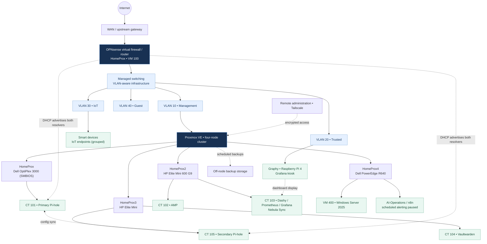
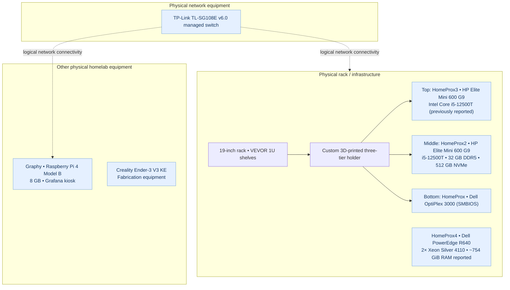

# Homelab Network Architecture

**Updated:** October 30, 2026

This is a **logical topology**, not a verified port-by-port cable map. It documents network segmentation, cluster placement, and service relationships. Physical uplinks and upstream WAN details are intentionally simplified. Dotted arrows indicate logical dependencies rather than physical cabling.

## Current Logical Network Diagram

[Open standalone Mermaid source](homelab-network.mmd)

## Physical Hardware Layout

The following diagram inventories the physical platforms separately from the virtual service topology above.

## Physical Hardware Inventory

**Model correction:** The latest `dmidecode` output from HomeProx identifies it as **Dell OptiPlex 3000**, not the earlier documented 7020 Micro. Chassis form factor remains to be confirmed separately.

This inventory documents **known, currently used** homelab hardware. Hardware specifications not confirmed from current records are deliberately left unspecified. The inventory is distinct from the logical network diagram; connections below do not assert verified switch-port assignments.

| Node / device | Physical hardware | Known details / current use |
|---|---|---|
| **HomeProx** | Dell OptiPlex 3000 (SMBIOS-reported) | Intel Core i5-12500T (6 cores / 12 threads); 2 × 16 GB DDR4-3200; Samsung 970 EVO Plus 1 TB NVMe; Realtek RTL8111/8168-family Gigabit Ethernet; bottom tier; primary Pi-hole CT101 and OPNsense VM100 |
| **HomeProx2** | HP Elite Mini 600 G9 Desktop PC | Intel Core i5-12500T (6 cores / 12 threads); 2 × 16 GB Micron DDR5-5600 running at 4800 MT/s; Samsung PM9A1 512 GB NVMe; Intel I219-LM Gigabit Ethernet; middle tier; AMP CT102 and monitoring CT103; NFS backup storage on root filesystem |
| **HomeProx3** | HP Elite Mini 600 G9 | Proxmox node; top tier; Intel Core i5-12500T previously reported; secondary Pi-hole CT105 and Vaultwarden CT104 |
| **HomeProx4** | Dell PowerEdge R640 | Rack server; dual Intel Xeon Silver 4110 processors; approximately 754 GiB usable RAM previously reported; Samsung 870 EVO 500 GB SSD used for AI storage; Windows Server and AI-Operations VMs |
| **Managed switch** | TP-Link TL-SG108E v6.0 | 8-port VLAN-capable physical switch |
| **Monitoring kiosk** | Raspberry Pi 4 Model B Rev 1.5 | 8 GB RAM; Graphy Grafana kiosk on trusted VLAN 20; Debian 13 (last reported) |
| **Rack** | 19-inch rack with VEVOR 1U vented cantilever shelves | 10-inch-deep shelves; 12-24 threaded rack mounting hardware and washers |
| **Micro-PC organizer** | Custom 3D-printed three-tier holder | Holds HomeProx, HomeProx2 and HomeProx3; M4 bolts and heat-set inserts |
| **3D printer** | Creality Ender-3 V3 KE | Used to fabricate the custom holder and other lab components; fabrication equipment, not a confirmed VLAN endpoint |

A separate **Netgear GS105 switch** has been discussed for a future re-cabling project but is **not shown as installed**. A planned additional SSD for HomeProx4 backup migration is likewise **not recorded as installed**.

## Segmentation and routing

| Network | Purpose | Documentation status |
|---|---|---|
| VLAN 10 | Infrastructure management | In use |
| VLAN 20 | Trusted clients, including Graphy | In use |
| VLAN 30 | IoT segment; Smart devices grouped beneath VLAN 30 in the logical diagram | Configured; DNS enforcement client validation pending |
| VLAN 40 | Guest segment | Configured; DNS enforcement client validation pending |

OPNsense handles inter-network policy. The primary and secondary Pi-hole instances are advertised as DNS resolvers; their independent operation and Nebula Sync synchronization have been tested, but HomeProx Linux resolver fallback has passed a simulated unavailable-primary test; Windows and other client failover remain unverified. Direct-DNS bypass rules were configured for four networks; comprehensive client testing and DNS-over-HTTPS controls remain outstanding.

The **Smart devices** node is a logical grouping for IoT endpoints, not a verified device inventory or claim that specific devices have joined VLAN 30.

## Four-node virtualization cluster

- **HomeProx:** OPNsense VM 100 and primary Pi-hole CT 101.
- **HomeProx2:** AMP CT 102 and monitoring/application stack CT 103 (Dashy, Prometheus, Grafana, exporters, Nebula Sync).
- **HomeProx3:** Vaultwarden CT 104 and secondary Pi-hole CT 105.
- **HomeProx4:** Windows Server 2025 VM 400 and AI-Operations tooling.

Proxmox scheduled backups use off-node storage. The n8n alert workflow has been configured and manually tested, but scheduled production execution remains unpublished/paused.

## Access and monitoring

Tailscale enables remote administrative access. Graphy is a Raspberry Pi 4 kiosk on the trusted network displaying Grafana dashboards; it is a display endpoint, not a monitoring server.

## Scope and limitations

This diagram does **not** assert verified switch-port assignments, redundant physical network paths, OPNsense HA, DNS client failover, or completed Windows Active Directory deployment. It intentionally omits private IPs, credentials, and firewall rule details. No hardware inspection details are included.
