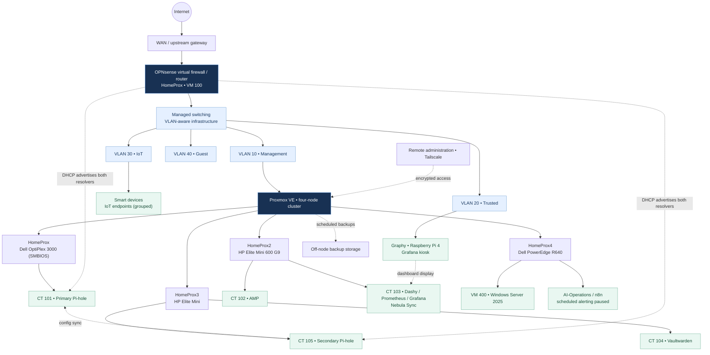
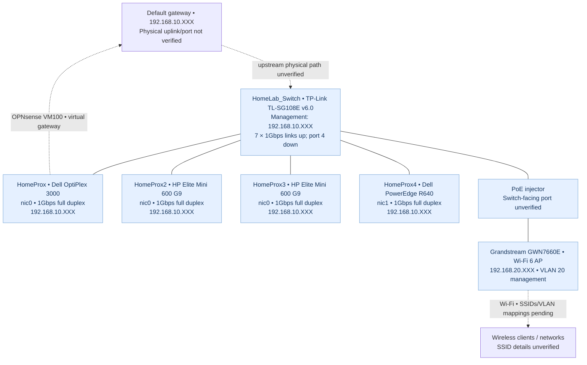
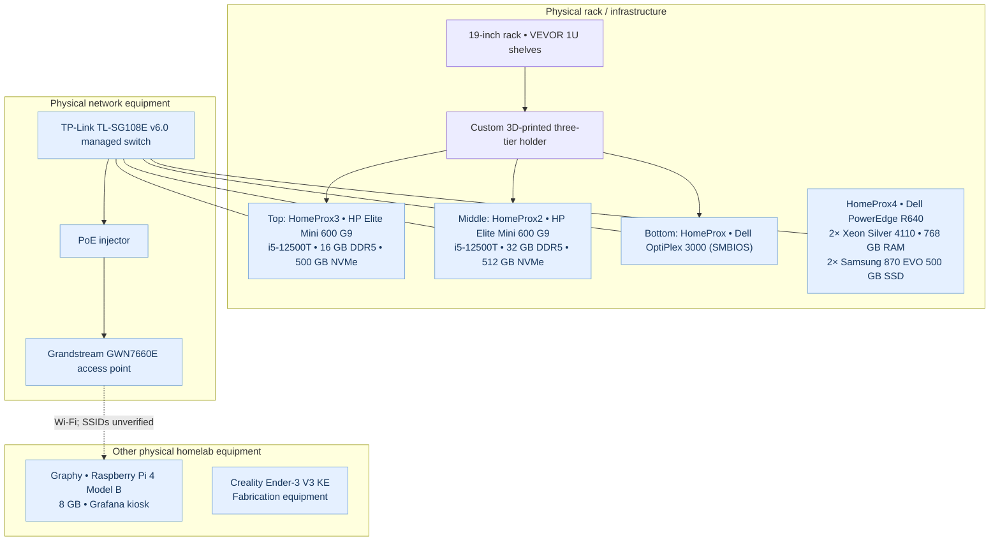

# Homelab Network Architecture

**Updated:** October 30, 2026

This is a **logical topology**, not a verified port-by-port cable map. It documents network segmentation, cluster placement, and service relationships. Physical uplinks and upstream WAN details are intentionally simplified. Dotted arrows indicate logical dependencies rather than physical cabling.

## Current Logical Network Diagram

[Open standalone Mermaid source](homelab-network.mmd)

## Physical Network Topology (verified October 30, 2026)

**Public documentation convention:** Internal host IP addresses are partially masked (for example, `192.168.20.XXX`). Exact host addresses are intentionally not published here.

Physical links below are confirmed at the **device level**, but exact TL-SG108E port assignments remain **unverified**. The PoE injector is inline between the switch and wireless AP. Dotted connections are Wi-Fi or logical associations, not additional Ethernet cables. Upstream gateway cabling and the AP's SSID-to-VLAN mapping remain unverified.

### Managed switch: port state and VLAN configuration

**Switch:** TP-Link TL-SG108E v6.0, device name `HomeLab_Switch`, management IP `192.168.10.XXX`, MAC `0C:EF:15:05:DA:07`, firmware `1.0.0 Build 20230218 Rel.50633`. 802.1Q VLAN is enabled. All eight ports are administratively enabled, configured for auto-negotiation with flow control off. Connected ports currently negotiate 1000 Mbps full duplex.

| Port | Observed link | PVID | Untagged VLAN | Tagged VLANs | Connected device |
|---|---|---|---|---|---|
| 1 | 1Gbps full | 100 | 100 | — | Unverified |
| 2 | 1Gbps full | 10 | 10 | — | Unverified |
| 3 | 1Gbps full | 10 | 10 | — | Unverified |
| 4 | Down | 20 | 20 | — | None detected |
| 5 | 1Gbps full | 20 | 20 | 30, 40 | Unverified |
| 6 | 1Gbps full | 10 | — | 10, 20, 30, 40, 100 | Unverified |
| 7 | 1Gbps full | 10 | — | 10, 20, 30, 40, 100 | Unverified |
| 8 | 1Gbps full | 10 | — | 10, 20, 30, 40, 100 | Unverified |

These are the switch's **configured** VLAN memberships, not proof of each connected endpoint's VLAN behavior. VLAN 1 appears in the configuration table without populated membership details. Port 1's VLAN 100 setting is **not** proof that it is the gateway uplink.

### Physical interface verification

| Node | Active physical NIC | MAC | Link | Management configuration |
|---|---|---|---|---|
| HomeProx | `nic0` | `6c:3c:8c:11:df:b0` | 1Gbps full | `vmbr0.10` • `192.168.10.XXX/24` |
| HomeProx2 | `nic0` | `7c:57:58:11:34:3d` | 1Gbps full | `vmbr0.10` • `192.168.10.XXX/24` |
| HomeProx3 | `nic0` | `5c:60:ba:c7:78:57` | 1Gbps full | `vmbr0.10` • `192.168.10.XXX/24` |
| HomeProx4 | `nic1` | `b0:26:28:18:a7:33` | 1Gbps full | `vmbr0` • `192.168.10.XXX/24` |

HomeProx, HomeProx2 and HomeProx3 have VLAN-aware `vmbr0` bridges. HomeProx4's `vmbr0` is **not** configured as VLAN-aware in `/etc/network/interfaces`; its other three physical interfaces have no detected link. HomeProx4 is directly connected to the TL-SG108E, as confirmed by the operator. The AP is connected to the switch **through a PoE injector**; its management address is reachable from HomeProx, but SSIDs remain pending credential recovery. A 15-second LLDP capture on HomeProx observed no advertisements, so exact switch ports cannot be assigned reliably from remote evidence.

## Physical Hardware Layout

The following diagram inventories the physical platforms separately from the virtual service topology above.

## Physical Hardware Inventory

**Model correction:** The latest `dmidecode` output from HomeProx identifies it as **Dell OptiPlex 3000**, not the earlier documented 7020 Micro. Chassis form factor remains to be confirmed separately.

This inventory documents **known, currently used** homelab hardware. Hardware specifications not confirmed from current records are deliberately left unspecified. The inventory is distinct from the logical network diagram; connections below do not assert verified switch-port assignments.

| Node / device | Physical hardware | Known details / current use |
|---|---|---|
| **HomeProx** | Dell OptiPlex 3000 (SMBIOS-reported) | Intel Core i5-12500T (6 cores / 12 threads); 2 × 16 GB DDR4-3200; Samsung 970 EVO Plus 1 TB NVMe; Realtek RTL8111/8168-family Gigabit Ethernet; bottom tier; primary Pi-hole CT101 and OPNsense VM100 |
| **HomeProx2** | HP Elite Mini 600 G9 Desktop PC | Intel Core i5-12500T (6 cores / 12 threads); 2 × 16 GB Micron DDR5-5600 running at 4800 MT/s; Samsung PM9A1 512 GB NVMe; Intel I219-LM Gigabit Ethernet; middle tier; AMP CT102 and monitoring CT103; NFS backup storage on root filesystem |
| **HomeProx3** | HP Elite Mini 600 G9 Desktop PC | Intel Core i5-12500T (6 cores / 12 threads); 8 GB Samsung + 8 GB SK Hynix DDR5-4800; Samsung SSD 980 500 GB NVMe; Intel I219-LM Gigabit Ethernet; top tier; secondary Pi-hole CT105 and Vaultwarden CT104 |
| **HomeProx4** | Dell PowerEdge R640 | 2 × Intel Xeon Silver 4110 (16 cores / 32 threads total); 24 × 32 GB registered ECC DDR4-2666 operating at 2400 MT/s (768 GB installed, ~754 GiB Linux-reported); 2 × Samsung 870 EVO 500 GB SATA SSDs; 2 × Broadcom BCM5720 Gigabit Ethernet and 2 × BCM57412 10GbE ports (three of four physical interfaces have no link; nic1 active at 1Gbps); Windows Server and AI-Operations VMs |
| **Managed switch** | TP-Link TL-SG108E v6.0 | HomeLab_Switch; 192.168.10.XXX; seven active 1Gbps links; port 4 down; VLAN/PVID table above |
| **Wireless access point** | Grandstream GWN7660E | 192.168.20.XXX (VLAN 20); connected to TL-SG108E through a PoE injector; SSIDs and switch port pending verification |
| **PoE injector** | Model unverified | Inline between managed switch and GWN7660E access point |
| **Monitoring kiosk** | Raspberry Pi 4 Model B Rev 1.5 | 8 GB RAM; Graphy Grafana kiosk on trusted VLAN 20; Debian 13 (last reported) |
| **Rack** | 19-inch rack with VEVOR 1U vented cantilever shelves | 10-inch-deep shelves; 12-24 threaded rack mounting hardware and washers |
| **Micro-PC organizer** | Custom 3D-printed three-tier holder | Holds HomeProx, HomeProx2 and HomeProx3; M4 bolts and heat-set inserts |
| **3D printer** | Creality Ender-3 V3 KE | Used to fabricate the custom holder and other lab components; fabrication equipment, not a confirmed VLAN endpoint |

A separate **Netgear GS105 switch** has been discussed for a future re-cabling project but is **not shown as installed**. The proposed backup-storage migration remains pending; the two currently detected Samsung 870 EVO SSDs do not establish that a dedicated backup disk has been provisioned.

## Segmentation and routing

| Network | Purpose | Documentation status |
|---|---|---|
| VLAN 10 | Infrastructure management | In use |
| VLAN 20 | Trusted clients, including Graphy | In use |
| VLAN 30 | IoT segment; Smart devices grouped beneath VLAN 30 in the logical diagram | Configured; DNS enforcement client validation pending |
| VLAN 40 | Guest segment | Configured; DNS enforcement client validation pending |

OPNsense handles inter-network policy. The primary and secondary Pi-hole instances are advertised as DNS resolvers; their independent operation and Nebula Sync synchronization have been tested, but HomeProx Linux resolver fallback has passed a simulated unavailable-primary test; Windows and other client failover remain unverified. Direct-DNS bypass rules were configured for four networks; comprehensive client testing and DNS-over-HTTPS controls remain outstanding.

The **Smart devices** node is a logical grouping for IoT endpoints, not a verified device inventory or claim that specific devices have joined VLAN 30.

## Four-node virtualization cluster

- **HomeProx:** OPNsense VM 100 and primary Pi-hole CT 101.
- **HomeProx2:** AMP CT 102 and monitoring/application stack CT 103 (Dashy, Prometheus, Grafana, exporters, Nebula Sync).
- **HomeProx3:** Vaultwarden CT 104 and secondary Pi-hole CT 105.
- **HomeProx4:** Windows Server 2025 VM 400 and AI-Operations tooling.

Proxmox scheduled backups use off-node storage. The n8n alert workflow has been configured and manually tested, but scheduled production execution remains unpublished/paused.

## Access and monitoring

Tailscale enables remote administrative access. Graphy is a Raspberry Pi 4 kiosk on the trusted network displaying Grafana dashboards; it is a display endpoint, not a monitoring server.

## Scope and limitations

This diagram does **not** assert verified switch-port assignments, redundant physical network paths, OPNsense HA, DNS client failover, or completed Windows Active Directory deployment. Management IPs are included for topology documentation; credentials and firewall rule details are omitted.
