# Technical Homelab Network Topology

## Overview

This diagram documents the logical topology of my homelab and the relationship between the physical network, Proxmox VE cluster, OPNsense firewall, VLANs, infrastructure services, monitoring, and secure remote administration.

The diagram is intentionally sanitized for public documentation and does not expose internal IP addressing or credentials.

---

## Network Topology

```mermaid
flowchart TB
    INTERNET((Internet))
    REMOTE["Remote Admin Device<br/>Laptop / Mobile"]
    TS["Tailscale<br/>Encrypted Overlay"]

    subgraph CLUSTER["4-Node Proxmox VE Cluster"]
        subgraph HP1["Node A — Dell OptiPlex 3000"]
            OPNSENSE["OPNsense VM<br/>Active Router / Firewall"]
            PIHOLE["Primary Pi-hole LXC<br/>DNS Filtering"]
            TSR["Tailscale<br/>Subnet Router"]
        end

        subgraph HP2["Node B — HP Elite Mini 600 G9"]
            AMP["AMP / Minecraft LXC"]
            BACKUP["NFS Backup Storage"]
            MON["Monitoring LXC"]
            PROM["Prometheus"]
            GRAF["Grafana"]
            DASH["Dashy"]
            OPNSENSE2["Standby OPNsense VM<br/>Not Automatic Failover"]
            MON --> PROM
            MON --> GRAF
            MON --> DASH
        end

        subgraph HP3["Node C — HP Elite Mini 600 G9"]
            PIHOLE2["Secondary Pi-hole LXC<br/>DNS Filtering"]
            OPNSENSE3["Standby OPNsense VM<br/>Not Automatic Failover"]
        end

        subgraph HP4["Node D — Dell PowerEdge R640"]
            WIN["Windows Server 2025 VM<br/>Lab Workloads"]
        end
    end

    SWITCH["Managed Ethernet Switch"]
    subgraph VLANS["Deployed VLAN Segments"]
        VLAN10["VLAN 10 — Management"]
        VLAN20["VLAN 20 — Trusted"]
        VLAN30["VLAN 30 — IoT / Guest Segmentation"]
        VLAN40["VLAN 40 — Guest / IoT Segmentation"]
        VLAN50["VLAN 50 — Unrestricted Internet Wi-Fi"]
        VLAN100["VLAN 100 — Infrastructure Network"]
    end

    DISPLAY["Raspberry Pi<br/>Monitoring Kiosk"]

    INTERNET --> OPNSENSE
    OPNSENSE --> SWITCH
    SWITCH --> VLAN10
    SWITCH --> VLAN20
    SWITCH --> VLAN30
    SWITCH --> VLAN40
    SWITCH --> VLAN50
    SWITCH --> VLAN100
    SWITCH <-->|"802.1Q VLAN Traffic"| HP1
    SWITCH <-->|"802.1Q VLAN Traffic"| HP2
    SWITCH <-->|"802.1Q VLAN Traffic"| HP3
    SWITCH <-->|"802.1Q VLAN Traffic"| HP4
    OPNSENSE -->|"Routing / Firewall Policy"| VLANS
    VLAN10 --> PIHOLE
    VLAN10 --> PIHOLE2
    VLAN10 --> MON
    VLAN20 -->|"DNS Queries"| PIHOLE
    VLAN20 -.->|"Alternate Resolver"| PIHOLE2
    PIHOLE -->|"Permitted DNS Queries"| INTERNET
    PIHOLE2 -->|"Permitted DNS Queries"| INTERNET
    VLAN50 -->|"External DNS / Internet"| INTERNET
    REMOTE --> TS
    TS --> TSR
    TSR -->|"Subnet Routing"| VLAN10
    DISPLAY -.->|"Dashboard Display"| GRAF
    BACKUP -.->|"Infrastructure Backups"| HP1
```



---

# Physical Infrastructure

The homelab consists of four Proxmox VE nodes connected through managed Ethernet switching.

| Public alias | Hardware | Primary role |
|---|---|---|
| Node A | Dell OptiPlex 3000 | Core infrastructure, active OPNsense firewall, and primary Pi-hole |
| Node B | HP Elite Mini 600 G9 | Applications, monitoring, and NFS backup storage |
| Node C | HP Elite Mini 600 G9 | Infrastructure containers and secondary Pi-hole |
| Node D | Dell PowerEdge R640 | Windows Server lab and additional virtualization workloads |

All four nodes participate in the Proxmox VE cluster using Corosync.

The three mini-PC nodes are installed in a custom 3D-printed holder, while the PowerEdge R640 provides additional rack-mounted compute capacity.

---

# Layer 2 Network

A managed Ethernet switch provides VLAN-aware Layer 2 connectivity between the physical systems.

The switch is responsible for:

- VLAN membership
- Tagged traffic
- Untagged traffic
- PVID assignment
- Connectivity between infrastructure devices

802.1Q VLAN tagging allows multiple logical networks to share physical Ethernet infrastructure while remaining logically separated.

---

# Layer 3 Network

OPNsense provides Layer 3 services for the environment.

Responsibilities include:

- Default gateway services
- Inter-VLAN routing
- Firewall policy
- DHCP
- Network segmentation
- Internet routing

Traffic moving between network segments is routed through OPNsense, allowing firewall policy to control communication between security boundaries.

---

# Management Network

VLAN 10 is used for infrastructure management.

This network contains or provides access to systems such as:

- Proxmox hosts
- Infrastructure services
- Monitoring
- Administrative interfaces

Separating management traffic from ordinary client traffic reduces unnecessary exposure of infrastructure interfaces.

---

# Trusted Network

VLAN 20 is used for trusted client devices.

This separates normal endpoint traffic from the infrastructure management network.

Communication between the trusted network and infrastructure networks can be controlled through OPNsense firewall policy.

---

# DNS Architecture

Two Pi-hole instances provide DNS filtering on separate Proxmox nodes:

- **Node A:** Primary Pi-hole
- **Node C:** Secondary Pi-hole

The general DNS path is:

```text
Client
   |
   +----> Primary Pi-hole (Node A)
   |
   +----> Secondary Pi-hole (Node C)
                 |
                 v
           Upstream DNS
```

The Pi-hole instances provide DNS filtering and separate resolver availability. Independent resolution and selected resolver-fallback behavior have been verified.

Automatic DNS failover for every client platform has not been established.

The dedicated unrestricted wireless VLAN 50 uses external DNS rather than Pi-hole filtering.

---

# Monitoring Architecture

A dedicated LXC container on Node B hosts the primary monitoring environment.

The monitoring stack includes:

- Prometheus
- Grafana
- Dashy

Prometheus provides metrics collection while Grafana provides visualization.

Dashy provides a centralized interface for accessing homelab services.

A Raspberry Pi is used as a dedicated physical kiosk for displaying monitoring information.

---

# Remote Administration

Tailscale provides secure remote administrative connectivity.

Node A operates as a subnet router for the management network.

The general remote-access path is:

```text
Remote Laptop / Mobile Device
            |
            v
       Tailscale
            |
            v
   Node A Subnet Router
            |
            v
     Management VLAN
            |
            v
 Internal Infrastructure
```

This allows authorized remote devices to reach internal management services without directly publishing those interfaces to the public Internet.

---

# Backup Architecture

Node B provides NFS-based backup storage for the Proxmox environment.

Scheduled Proxmox backup jobs use `vzdump` to create VM and LXC backup archives with configured retention policies.

Successful backup tasks and a separate manual monitoring-container backup have been documented.

**Validation limitations:**

- Successful backup creation does not establish successful restoration.
- Complete scheduled backup coverage for every workload has not been verified.
- Backup storage capacity remains an operational consideration.

The documented backup infrastructure is operational, while comprehensive recovery validation remains outstanding.

---

# Firewall Boundaries

The architecture uses OPNsense as the primary policy-enforcement point between logical networks.

Conceptually:

```text
Trusted Network
      |
      v
   OPNsense
      |
 Firewall Policy
      |
      v
Management Network
```

This allows communication to be permitted according to operational requirements rather than allowing unrestricted traffic between every network.

---

# Virtualization Boundaries

Several critical infrastructure services are virtualized.

This provides flexibility but also creates dependencies.

For example, Node A currently hosts:

- Active OPNsense
- Pi-hole
- Tailscale subnet routing

Maintenance on this hypervisor therefore requires consideration of the network services that depend on it.

This dependency was identified during rolling Proxmox maintenance and is incorporated into future change planning.

---

# Firewall Resiliency

Additional OPNsense virtual machines exist on other Proxmox nodes as standby instances.

They are intentionally represented as:

```text
Standby OPNsense
Not Automatic Failover
```

They should not be considered a high-availability firewall solution until failover behavior has been explicitly configured and tested.

---

# Security Principles

The network architecture follows several core principles.

## Segmentation

Systems with different purposes and trust levels should not automatically share the same network.

## Least Privilege

Inter-network communication should be permitted only where operationally required.

## Reduced Exposure

Administrative services should not be directly exposed to the public Internet unless absolutely necessary.

## Defense in Depth

Security relies on multiple controls, including:

- OPNsense firewalling
- VLAN segmentation
- Tailscale
- DNS filtering
- Endpoint security
- Monitoring
- Backups

## Recoverability

Infrastructure security also includes the ability to recover from configuration mistakes, failed updates, storage failures, and other incidents.

---

# Skills Demonstrated

This architecture demonstrates practical experience with:

- Network architecture
- Proxmox VE
- OPNsense
- VLANs
- IEEE 802.1Q
- Managed switching
- Linux bridges
- Inter-VLAN routing
- Firewall policy
- DNS
- Pi-hole
- Tailscale
- Secure remote administration
- Prometheus
- Grafana
- Infrastructure monitoring
- LXC
- Virtual machines
- NFS
- Backup architecture
- Network segmentation
- Infrastructure documentation

---

# Project Status

**Completed — Deployed Four-Node Infrastructure**

The documented homelab architecture includes:

- Four-node Proxmox VE cluster
- Active OPNsense routing and firewall services
- Management, trusted, IoT, guest, and unrestricted-internet VLAN segmentation
- Redundant Pi-hole DNS services
- Prometheus, Grafana, and Dashy monitoring
- Raspberry Pi monitoring kiosk
- Tailscale remote administration
- Scheduled Proxmox backup infrastructure
- Windows Server 2025 lab environment

**Validation limitations:**

- Standby OPNsense virtual machines do not constitute verified automatic firewall failover.
- Backup restoration remains unverified.
- DNS resolver failover has not been validated across every client platform.
- Monitoring coverage and advanced alerting are not claimed to be comprehensive.

The documented architecture represents deployed infrastructure and completed technical work rather than proposed future capabilities.
